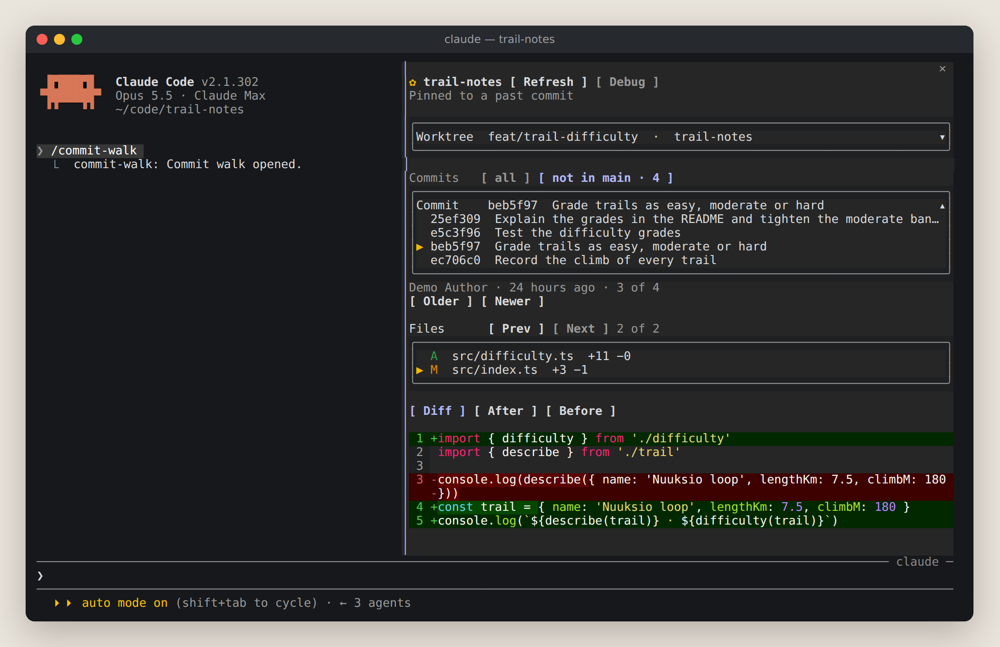
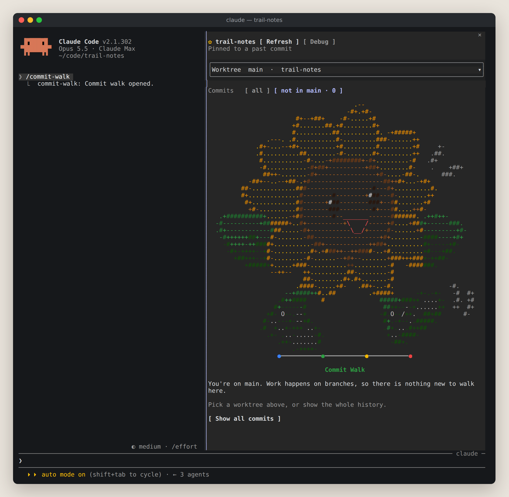

# commit-walk

<p align="center"></p>

A Claude Code pane for walking a Git repository worktree by worktree and
commit by commit. Pick a worktree, a commit and one of its changed files.
Read the file as a diff, or as the whole file after or before the commit.

It is built for watching an agent's work as it lands. The pane follows new
commits while Claude edits, and it can step back through history without
leaving the session.

Everything comes from git and is only read. The plugin gives the model no
tool, writes nothing to the repository and makes no network requests.

<p align="center"></p>

<p align="center"><sub>A walk through a demo branch, recorded in a real session (<a href="assets/commit-walk-demo.mp4">MP4</a>).</sub></p>

## Contents

- [Requirements](#requirements)
- [Install](#install)
- [Use](#use)
- [What the pane shows](#what-the-pane-shows)
- [How it behaves](#how-it-behaves)
- [Limits](#limits)
- [What it runs](#what-it-runs)
- [Troubleshooting](#troubleshooting)
- [Develop](#develop)
- [Ideas not built yet](#ideas-not-built-yet)

## Requirements

| What | Version |
| --- | --- |
| Claude Code | 2.1.292 or later, for the mods API. Tested on 2.1.292 and 2.1.302. |
| Git | 2.36 or later, for NUL-separated `git worktree list` output. 2.41 or later for the base-branch range |

It draws the same on the terminal, the desktop app, VS Code and the mobile
app: every control is a button.

## Install

The repository is private. Installing needs read access to it on GitHub and
a git credential for github.com on the machine. That is an SSH key, or
`gh auth login` followed by `gh auth setup-git`. The install never prompts
for a credential.

At the prompt of a Claude Code terminal session:

```
/plugin install commit-walk --marketplace mahdava/commit-walk
```

Or from a shell:

```
claude plugin install commit-walk --marketplace mahdava/commit-walk
```

Answer `y` to add the marketplace, then pick the user scope. The plugin is
active at once in that session, and in every session started afterwards.

In the desktop app, where `/plugin` does not run, click + next to the prompt
box, then Plugins. Add the marketplace `mahdava/commit-walk`, then add the
plugin.

To update later:

```
claude plugin marketplace update commit-walk
claude plugin update commit-walk@commit-walk
```

To remove it:

```
claude plugin uninstall commit-walk@commit-walk
```

## Use

Start Claude Code inside a Git repository, then run `/commit-walk`.

| Command | What it does |
| --- | --- |
| `/commit-walk` | Opens the pane, or closes it when it is open |
| `/commit-walk refresh` | Opens the pane if needed and reads the repository again |
| `/commit-walk close` | Closes the pane |
| `/commit-walk debug` | Shows or hides the debug section, opening the pane if needed |

`/commit-walk` runs at once, even in the middle of a turn. Before 1.3.0 the
command was `/commits`.

### Keyboard

The pane takes the keyboard when it opens. Later, click it, or press
`ctrl+x` then `Tab`, to give it the keyboard again. While it has the
keyboard:

| Key | Action |
| --- | --- |
| `Tab` | Moves between the controls |
| `Enter` | Presses the focused row or button |
| Arrows | Scroll the pane |
| `o` / `n` | Older / newer commit |
| `k` / `j` | Previous / next file |
| `d` / `a` / `b` | Diff / After / Before |
| `r` | Refresh |
| `x` | Shows or hides the debug section |
| `Esc` | Closes the pane |

## What the pane shows

<p align="center"></p>

From the top down:

1. **The repository's name**, after a ✿, and a Refresh button. Under them, a line says
   whether the pane follows the newest commit or is pinned to an older one.
   It shows "Loading…" while git runs, and git's message if a step failed.
2. **Worktree**, a framed row showing the current worktree: its branch, or
   "detached @ sha" without one, then its folder name. Click anywhere on the
   row to unfold the list of every worktree under it. Click the row again,
   or pick one, to fold it. Locked worktrees are marked. Bare and prunable
   ones are left out.
3. **Commits**, a row of buttons choosing which commits the list starts
   from, shown only when the worktree offers more than its whole history:
   - **all**: the whole history.
   - **not in origin/main · 12**: the commits the default branch does not
     have yet. Offered off the default branch.
   - **since feat/base · 3**: the commits since the branch this one grew
     from, for stacked branches. Offered when that base is not the default
     branch itself.

   **not in** is chosen by default, since work normally happens on
   branches. On the default branch itself, or on a branch level with it,
   that range is empty and the pane shows the welcome screen. On the
   default branch it says so and offers **Show all commits** (`h`). On a
   branch level with it, the pane waits there and moves to the first commit
   as soon as it lands. A range you pick becomes the choice and follows you
   across worktrees; where a worktree does not offer it, the list shows all
   commits.

   The default branch is whatever `origin/HEAD` points at, `master`
   included. Without `origin/HEAD` it is local `main`, local `master`,
   `origin/main` or `origin/master`, in that order. The base branch is the
   nearest other local branch: the one missing the fewest of this branch's
   commits.
4. **Commit**, a framed row that unfolds the same way, listing the newest
   100 commits of the chosen range by short SHA and subject. Under it are
   the author, the relative date, whether it is a merge or the root commit,
   and its position, then the Older and Newer buttons.
5. **Files**, always unfolded: the files the commit changed, with their
   status letter in colour and their line counts. Renames show as
   `old → new`, and binary files say "binary". Prev and Next sit above it.

<p align="center"></p>

Every list is a frame of whole-row buttons, so a click on a row picks it,
and the row under the pointer is highlighted. The selected row is marked ▶.
A list shows 8 rows. A longer one gets a scroll column on its right:

- **▲ and ▼** page through the list 7 rows at a time without changing the
  selection.
- **The thumb** in between shows where the visible rows are.
- **A line under the list** reads "9–16 of 40 files".

A row too long for the pane ends in "…". Hovering it shows its whole line
in a card just below it, which disappears when the pointer leaves. That
needs a terminal that reports the pointer, like Claude Code's fullscreen
mode. When the selected file's row is cut, its whole name, `old → new` for
a rename, also appears under the file list, so it is readable without a
pointer too.

A scrolled list stays where you put it. It comes back around the selection
only when the selection moves out of view, for example with `j` or `k`.

6. **The view**, one of three:

| View | Shows |
| --- | --- |
| Diff | The change, coloured, with line numbers from git's hunks |
| After | The whole file as the commit left it, numbered from line 1 |
| Before | The whole file as it was in the commit's first parent |

The status letters are git's own:

| Letter | Meaning |
| --- | --- |
| `A` | Added |
| `M` | Modified |
| `D` | Deleted |
| `R` | Renamed, possibly with changes |
| `C` | Copied |
| `T` | Type changed, for example a file became a symlink |
| `U` | Unmerged |

### The welcome screen

The sunflower from the logo walks a commit line whenever there is nothing to
walk yet:

<p align="center"></p>

It shows while the repository is first read, outside a repository, on a
worktree with no commits yet, and under "not in" on the default branch or a
branch with nothing beyond it. On a new worktree the pane waits there and
moves to the first commit as soon as it lands.

The art is drawn in the logo's colours: yellow petals with orange outlines,
a brown face, green leaves and sneakers. The pane picks the largest version
that fits with room for the message under it:

| Version | Size | Shown when the pane has |
| --- | --- | --- |
| Large sunflower | 71 × 36 | 73 columns and 46 rows |
| Medium sunflower | 45 × 22 | 47 columns and 32 rows |
| Small sunflower | 23 × 11 | Any room: the pane is always at least 24 columns |

The pane's own rows sit above the art, so the large one needs a terminal
about 55 rows tall. The screenshot above is 128 × 64.

All three sunflowers are Lucia's drawings. The two larger ones take their
colours from a mask per row in `hooks/welcome.ts`, one letter per character.
The small one was made in her ASCII Fantasy Map Builder and keeps its
palette: every character has its own colour, as in the builder.

## How it behaves

- **It starts where you are.** The pane opens on the worktree that holds the
  session's folder, at its newest commit not yet in the default branch, and
  its first changed file.
- **It follows new work.** While the newest commit is selected, a refresh
  moves to the new newest commit. Refreshes happen after Claude's successful
  Edit, Write, NotebookEdit and non-read-only Bash calls, and after each
  turn, about 0.4 s after the last one. They run only while the pane is open.
- **It stays put on history.** On an older commit, a refresh keeps that
  commit and file, as long as they still exist.
- **Selections are by identity.** The pane remembers the worktree path, the
  commit SHA and the file path, not list positions. New commits never shift
  what you are looking at.
- **Diffs show the whole file** when it fits in the pane. Bigger changes fall
  back to 20 lines of context around each change, and the pane says so.
- **Merges compare with their first parent**, the branch that was merged
  into. A root commit compares with the empty tree.
- **Renames diff as renames.** Before reads the file under its old path.
- **A failure keeps what loaded.** If one git step fails, the pane keeps
  what it had and prints git's message. Outside a repository it says so and
  offers to try again.
- **Fast clicks never show stale results.** When a newer selection starts
  loading, the older load is dropped.
- **A plugin reload keeps your place.** The selection and the loaded data
  live in the session's plugin state, which survives a hot reload.

## Limits

| What | Limit | Past it |
| --- | --- | --- |
| Commits listed | 100 newest | Older commits are not reachable from the pane |
| Rows in one list | 8 at a time | ▲ and ▼ in its scroll column page through the rest |
| Text in the view | 60,000 characters | Cut on a line or hunk boundary, with a note |
| File size for After and Before | 4 MB | A note instead of the file |
| One git command | 20 s | That step fails and shows the error |

Binary files are listed but not shown. There is no view of uncommitted
changes yet.

## What it runs

Only these git commands, through Claude Code's process runner, in the
selected worktree:

| Command | For |
| --- | --- |
| `rev-parse --show-toplevel` | Finding the repository |
| `worktree list --porcelain -z` | The worktree list |
| `log -z --max-count=100 HEAD` | The commit list |
| `diff-tree -r -M -z --name-status` and `--numstat` | Changed files and line counts |
| `diff-tree -p -M --unified=…` | The diff of one file |
| `cat-file -s` and `cat-file blob` | The file before or after |
| `hash-object -t tree /dev/null` | The empty tree, for root commits |

Every command runs with `GIT_OPTIONAL_LOCKS=0`, so reading never takes
git's index lock from an agent that is committing. Output is read
NUL-separated, so paths with spaces, quotes or non-ASCII characters come
through as they are. Claude Code runs git with repository hooks turned off.

### The debug section

`/commit-walk debug`, the `x` key or the Debug button shows a framed section
under the header:

- **Versions:** the plugin's and Claude Code's, and the surface.
- **The pane:** its size and placement, and which welcome art it chose.
- **Paths:** the session's folder and the repository.
- **The selection:** worktree, commit, file, view, following or pinned, and
  which list is open.
- **What loaded:** the counts, how long ago, and the last error.
- **The last 10 git commands:** exit code and time taken. A failing command
  is red and shows the first line of git's error.

It cannot help when Claude Code refuses the whole drawing, because then
nothing of the plugin is drawn. The debug log covers that case, as below.

## Troubleshooting

**On a Mac with Homebrew.** The `claude-code` cask follows Claude Code's
stable channel, about a week behind the latest. commit-walk works from
2.1.292, the stable version when 1.5.0 came out. For the newest Claude Code,
install the `claude-code@latest` cask instead.

**`/commit-walk` does not exist.** The plugin is not loaded in this session. Run
`/reload-plugins`, or start a new session. `claude plugin list` should show
`commit-walk` as enabled.

**"No repository to review".** The session's folder is not inside a Git
repository. Start Claude Code inside one.

**"Commit walk is open but not drawn yet".** No surface could place the
pane. A headless `claude -p` run draws nothing. In a terminal, widen the
window.

**The pane is empty, or closed right after opening.** Claude Code refused
to draw it. Versions before 1.1.0 did this on any branch with more than 64
commits, because a picker may hold at most 64 options. Version 1.4.0 did it
on Claude Code before 2.1.300, which refuses a button holding coloured text.
Update the plugin.
Otherwise, Claude Code refused the drawing for another reason.
Start Claude Code with `--debug` and look for a line containing
`ui.render (Pane)` and `does not validate`. It names the reason.

**A diff draws as plain text.** The diff was not in a form the code view
can colour. The debug log gives the reason on a line containing
"drawn as plain code".

**The pane does not follow Claude's commits.** It follows only while the
newest commit is selected. Press `n` until Newer is dimmed, or press `r`.

## Develop

The plugin is a Claude Code mod: a hooks module that runs inside Claude
Code's own plugin environment, with no Node APIs.

| File | Holds |
| --- | --- |
| `hooks/git.ts` | The git commands and NUL-safe parsers. It makes no engine calls, so tests drive it with canned output. |
| `hooks/register.tsx` | The hooks: the command, the refresh triggers and the pane |
| `hooks/window.ts` | The window of rows a long list shows |
| `hooks/welcome.ts` | The welcome art, with a colour mask per row |
| `types/index.d.ts` | The state contract: the values kept in the session's plugin state |
| `tests/git.test.ts` | Parser and fitting tests |
| `tests/window.test.ts` | List window tests |
| `tests/pane.test.tsx` | Pane tests on the terminal, desktop and mobile surfaces |
| `.claude-plugin/plugin.json` | The manifest |
| `.claude-plugin/marketplace.json` | Makes the repository its own marketplace |
| `assets/commit-walk-logo.svg` | The logo |
| `assets/commit-walk-logo-outlined.svg` | The logo with a white outline, for dark backgrounds; the README shows it |
| `assets/logo.png` | The first logo, as a PNG |
| `assets/commit-walk-demo.gif`, `.mp4` | The demo at the top of this README |
| `assets/screenshots/` | The README's screenshots |
| `tools/screenshots/` | `make-media.sh` remakes the demo and screenshots from a real session in a throwaway repository; its header lists what it needs |

Checks:

```
claude plugin validate .
claude plugin test .
```

`claude plugin validate` reads the manifest, the marketplace file and the
module, and reports anything Claude Code would refuse. `claude plugin test`
runs the tests inside Claude Code's own plugin host.

Type-checking uses the API types that Claude Code writes into
`.claude-plugin/types/` when a session loads the plugin from a local folder,
as with `--plugin-dir` below. That folder is git-ignored. Once it exists:

```
npx -p typescript tsc -p .
```

To work on a local copy, start a session with the folder loaded:

```
claude --plugin-dir /path/to/commit-walk
```

Edits reload when the turn that made them ends. An installed copy picks up
changes with `/reload-plugins`.

Bump `version` in `.claude-plugin/plugin.json` with each change meant to
reach installs.

## Ideas not built yet

- A "Working tree" entry for uncommitted changes.
- A small "new commit" marker while pinned to an older commit.
- Remembering the last worktree across sessions.
- Picking which parent a merge compares with.
- Paging further back than 100 commits.
