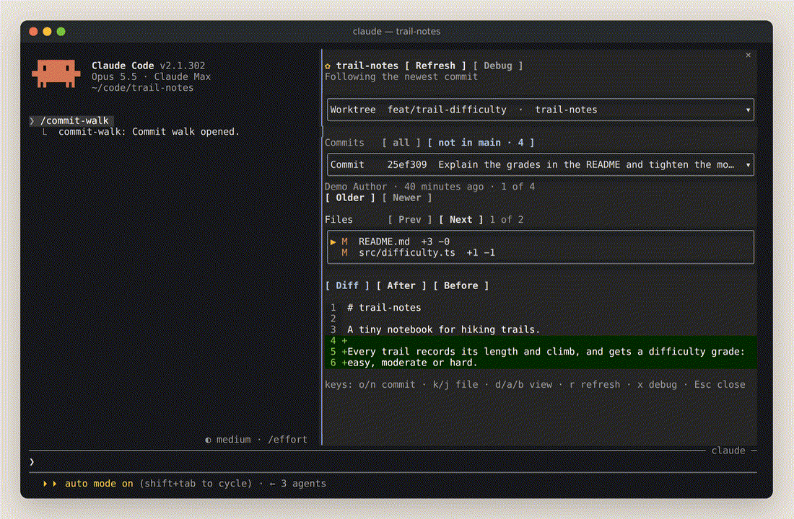
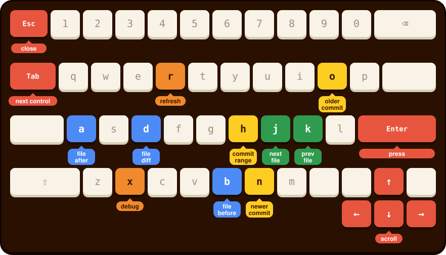

<h1 align="center"></h1>

A Claude Code pane for walking a Git repository worktree by worktree and
commit by commit. Pick a worktree, a commit and one of its changed files.
Read the file as a diff, or as the whole file after or before the commit.

It is built for watching an agent's work as it lands. The pane follows new
commits while Claude edits, and it can step back through history without
leaving the session.

Everything comes from git and is only read. The plugin gives the model no
tool, writes nothing to the repository and makes no network requests.

<p align="center"></p>

<p align="center"><sub>A walk through a demo branch, recorded in a real session. The yellow pointer shows what is clicked, and the keycaps what is pressed, in the colours of the keyboard below (<a href="assets/commit-walk-demo.mp4">MP4</a>).</sub></p>

## Install

```
/plugin install commit-walk --marketplace mahdava/commit-walk
```

It needs Claude Code 2.1.292 or later, Git 2.36 or later, and read access to
this private repository. Installing from a shell or the desktop app,
updating and removing are in [docs/INSTALL.md](docs/INSTALL.md).

## Use

Run `/commit-walk` in a Claude Code session started inside a Git repository.
It opens the pane, or closes it when it is open. The pane takes the keyboard
when it opens; later, click it, or press `ctrl+x` then `Tab`, to give the
keyboard back to it.

<p align="center"></p>

<details>
<summary>Keys as a table</summary>

| Key | Action |
| --- | --- |
| `o` / `n` | Older commit / newer commit |
| `h` | Commit range: all, not in main, since the base branch, in turn |
| `j` / `k` | Next file / previous file |
| `d` / `a` / `b` | File diff / file after / file before |
| `r` | Refresh |
| `x` | Debug: shows or hides the debug section |
| `Esc` | Close the pane |
| `Tab` | Next control |
| `Enter` | Press the focused row or button |
| Arrows | Scroll the pane |

</details>

## More

- [Guide](docs/GUIDE.md): the commands, what the pane shows, how it follows new commits, and its limits
- [Install](docs/INSTALL.md): requirements, installing from a shell or the desktop app, updating and removing
- [Troubleshooting](docs/TROUBLESHOOTING.md): the git commands it runs, the debug section, and fixes for common problems
- [Develop](docs/DEVELOP.md): the files, the checks and working on a local copy

## Credits

- The logo's lettering is from the [SuperTrend](https://nhfonts.gumroad.com/l/super-trend-font) font by [NHFonts](https://nhfonts.gumroad.com/).
- ASCII art was generated by running the logo in [asciiart.eu's Image to ASCII](https://www.asciiart.eu/image-to-ascii) and modifying it personally.
