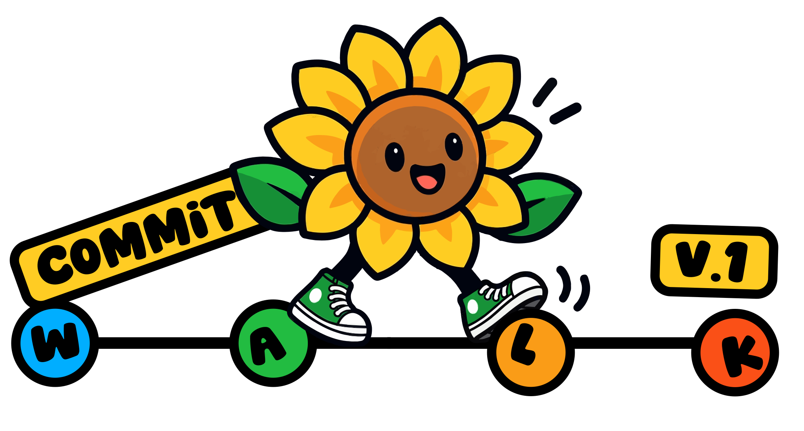

<p align="center"><a href="../README.md"></a></p>

# <picture></picture> Developing Commit Walk

The plugin is a Claude Code mod: a hooks module that runs inside Claude
Code's own plugin environment, with no Node APIs.

Two rules of that environment shape how the code is split:

- **`$` stays in register.tsx.** Claude Code before 2.1.300 follows `$` only
  into functions of the file that holds it, never into an imported one. So
  everything that uses `$` lives in `register.tsx`. The pane's parts in
  `hooks/pane/` never take `$`: they draw from the values `register.tsx`
  reads and call the actions it builds. Once the oldest supported Claude
  Code is 2.1.300 or later, the loading and stepping can move to a file of
  their own.
- **An atom is declared where it is read or written.** `read` and `update`
  take only an atom declared in the same file, so the atoms are in
  `register.tsx` too.

| File | Holds |
| --- | --- |
| `hooks/register.tsx` | Everything that uses `$`: the hooks, the state, loading from git and stepping. It builds the actions the pane's buttons take. |
| `hooks/state.ts` | Constants and the first values of the state |
| `hooks/git.ts` | The git commands and NUL-safe parsers. It makes no engine calls, so tests drive it with canned output. |
| `hooks/labels.ts` | Worktrees, commits and files as one line of text |
| `hooks/pane/index.tsx` | The pane, one screen at a time: no repository, reading, nothing to walk, the walk |
| `hooks/pane/frame.ts` | What every part draws with: the values, the actions, the elements and the room |
| `hooks/pane/header.tsx`, `debug.tsx`, `commits.tsx`, `ranges.tsx`, `files.tsx`, `view.tsx`, `welcome.tsx` | One part of the pane each |
| `hooks/pane/list.tsx` | The lists: rows, scroll column, hover cards, folding |
| `hooks/window.ts` | The window of rows a long list shows |
| `hooks/welcome.ts` | The welcome art, with a colour mask per row |
| `types/index.d.ts` | The state contract: the values kept in the session's plugin state |
| `tests/support.ts` | The tests' fake repository, fake git and engine, and helpers that read the drawing |
| `tests/walk.test.tsx`, `lists.test.tsx`, `ranges.test.tsx`, `welcome.test.tsx`, `debug.test.tsx` | Pane tests by feature, on the terminal, desktop and mobile surfaces |
| `tests/git.test.ts` | Parser and fitting tests |
| `tests/window.test.ts` | List window tests |
| `LICENSE` | The MIT License, for the code and documentation |
| `ARTWORK-LICENSE.md` | The logos, keyboard picture and sunflower drawings: © Lucia Nazzaro, all rights reserved |
| `THIRD-PARTY-NOTICES.md`, `LICENSES/` | What is others' work, and their licences in full |
| `.claude-plugin/plugin.json` | The manifest |
| `.claude-plugin/marketplace.json` | Makes the repository its own marketplace |
| `assets/commit-walk-logo.svg` | The logo |
| `assets/commit-walk-logo-outlined.svg` | The logo with a white outline, for dark backgrounds; the README shows it |
| `assets/commit-walk-demo.gif`, `.mp4` | The demo at the top of the README |
| `assets/screenshots/` | The guide's screenshot |
| `assets/sunflower-emoji.svg` | Noto Emoji's 🌻 (Apache 2.0), before each README heading with an empty alt so screen readers skip it |
| `assets/keyboard.svg` | The keys the pane uses, on a keyboard; the README shows it |
| `tools/screenshots/` | `make-media.sh` remakes the demo and screenshot from a real session in a throwaway repository; its header lists what it needs |
| `tools/art/keys.mjs` | What each key does and its colour, shared by the keyboard image and the demo's keycaps |
| `tools/art/keyboard.mjs` | Draws `assets/keyboard.svg`: `node tools/art/keyboard.mjs > assets/keyboard.svg` |
| `docs/` | The guide, install, git commands, troubleshooting and this page, linked from the README |

Checks:

```
claude plugin validate .
claude plugin test .
```

`claude plugin validate` reads the manifest, the marketplace file and the
module, and reports anything Claude Code would refuse. `claude plugin test`
runs the tests inside Claude Code's own plugin host.

Type-checking uses the API types that Claude Code writes into
`.claude-plugin/types/` when a session loads the plugin from a local folder,
as with `--plugin-dir` below. That folder is git-ignored. Once it exists:

```
npx -p typescript tsc -p .
```

To work on a local copy, start a session with the folder loaded:

```
claude --plugin-dir /path/to/commit-walk
```

Edits reload when the turn that made them ends. An installed copy picks up
changes with `/reload-plugins`.

Bump `version` in `.claude-plugin/plugin.json` with each change meant to
reach installs.
