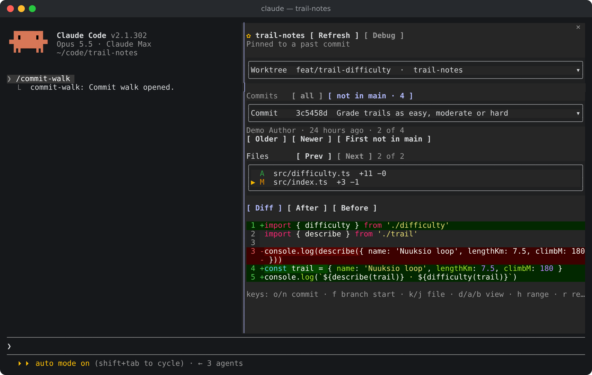

# <picture></picture> Using Commit Walk

This guide covers everything the pane does once it is open: the commands
that open and close it, each part of the pane from top to bottom, how it
follows new commits, and its limits.

## <picture></picture> Commands

Start Claude Code inside a Git repository, then run `/commit-walk`.

| Command | What it does |
| --- | --- |
| `/commit-walk` | Opens the pane, or closes it when it is open |
| `/commit-walk refresh` | Opens the pane if needed and reads the repository again |
| `/commit-walk close` | Closes the pane |
| `/commit-walk debug` | Shows or hides the debug section, opening the pane if needed |

`/commit-walk` runs at once, even in the middle of a turn. Before 1.3.0 the
command was `/commits`.

## <picture></picture> What the pane shows

From the top down:

1. **The repository's name**, after a ✿, and a Refresh button. Under them, a line says
   whether the pane follows the newest commit, is pinned to an older one, or
   shows what is not committed yet.
   It shows "Loading…" while git runs, and git's message if a step failed.
2. **Worktree**, a framed row showing the current worktree: its branch, or
   "detached @ sha" without one, then its folder name. Click anywhere on the
   row to unfold the list of every worktree under it. Click the row again,
   or pick one, to fold it. Locked worktrees are marked. Bare and prunable
   ones are left out.
3. **Commits**, a row of buttons choosing which commits the list starts
   from, shown only when the worktree offers more than its whole history:
   - **all**: the whole history.
   - **not in origin/main · 12**: the commits the default branch does not
     have yet. Offered off the default branch.
   - **since feat/base · 3**: the commits since the branch this one grew
     from, for stacked branches. Offered when that base is not the default
     branch itself.

   **not in** is chosen by default, since work normally happens on
   branches. On the default branch itself, or on a branch level with it,
   that range is empty and the pane shows the welcome screen, unless there
   are uncommitted changes, which it then shows instead. On the
   default branch it says so and offers **Show all commits**. On a
   branch level with it, the pane waits there and moves to the first commit
   as soon as it lands. `h` moves to the next range the worktree offers,
   in turn, as does a click on a range. Switching keeps the selected commit
   when the new range has it, and otherwise moves to that range's newest. A
   range you pick becomes the choice and follows you across worktrees; where
   a worktree does not offer it, the list shows all commits.

   The default branch is whatever `origin/HEAD` points at, `master`
   included. Without `origin/HEAD` it is local `main`, local `master`,
   `origin/main` or `origin/master`, in that order. The base branch is the
   nearest other local branch: the one missing the fewest of this branch's
   commits.
4. **Commit**, a framed row that unfolds the same way, listing the newest
   100 commits of the chosen range by short SHA and subject. Under it are
   the author, the relative date, whether it is a merge or the root commit,
   and its position, then the Older and Newer buttons. While the worktree has
   uncommitted changes, the list's first row is **✿ Uncommitted changes · 3
   files**, and on the newest commit Newer reads **Uncommitted**. See
   [Uncommitted changes](#-uncommitted-changes).
5. **Files**, always unfolded: the files the commit changed, with their
   status letter in colour and their line counts. Renames show as
   `old → new`, and binary files say "binary". Prev and Next sit above it.

Every list is a frame of whole-row buttons, so a click on a row picks it,
and the row under the pointer is highlighted. The selected row is marked ▶.
A list shows 8 rows. A longer one gets a scroll column on its right:

- **▲ and ▼** page through the list 7 rows at a time without changing the
  selection.
- **The thumb** in between shows where the visible rows are.
- **A line under the list** reads "9–16 of 40 files".

A row too long for the pane ends in "…". Hovering it shows its whole line
in a card just below it, which disappears when the pointer leaves. That
needs a terminal that reports the pointer, like Claude Code's fullscreen
mode. When the selected file's row is cut, its whole name, `old → new` for
a rename, also appears under the file list, so it is readable without a
pointer too.

A scrolled list stays where you put it. It comes back around the selection
only when the selection moves out of view, for example with `j` or `k`.

6. **The view**, one of three:

| View | Shows |
| --- | --- |
| Diff | The change, coloured, with line numbers from git's hunks |
| After | The whole file as the commit left it, numbered from line 1 |
| Before | The whole file as it was in the commit's first parent |

The status letters are git's own:

| Letter | Meaning |
| --- | --- |
| `A` | Added |
| `M` | Modified |
| `D` | Deleted |
| `R` | Renamed, possibly with changes |
| `C` | Copied |
| `T` | Type changed, for example a file became a symlink |
| `U` | Unmerged |

## <picture></picture> Uncommitted changes

What the worktree holds that is not committed yet, such as Claude's edits
before it commits them, is one more stop after the newest commit. `n` or
Newer on the newest commit goes there, as does the commit list's first row.
It holds every staged, unstaged and untracked file, leaving out what
`.gitignore` skips. With no uncommitted changes, there is no such row and
Newer stays dimmed on the newest commit.

Each file shows git's two-letter status, as `git status --short` writes it:
the first letter is the staged change, the second the unstaged one.

| Letters | Meaning |
| --- | --- |
| `M ` | Changed and staged |
| ` M` | Changed, not staged |
| `MM` | Staged, then changed again |
| `A ` | A new file, staged |
| ` D` | Deleted, not staged |
| `R ` | Renamed, staged |
| `??` | Untracked: new, and not staged yet |

A label above the view says which part you are looking at: **✿ Staged
changes**, against the last commit, or **✿ Unstaged changes**, against what
is staged. A file staged and then changed again shows both parts in Diff,
each under its own label. After shows the file as it is now, and Before as
the last commit has it.

All of it comes from git. For a file changed on disk, After is rebuilt from
git's diff of the whole file, so the pane never reads your files itself.

When everything is committed, the pane moves on to the new commit and
follows it, as on the newest commit.

## <picture></picture> How it behaves

- **It starts where you are.** The pane opens on the worktree that holds the
  session's folder, at its newest commit not yet in the default branch, and
  its first changed file.
- **It follows new work.** While the newest commit is selected, a refresh
  moves to the new newest commit. Refreshes happen after Claude's successful
  Edit, Write, NotebookEdit and non-read-only Bash calls, and after each
  turn, about 0.4 s after the last one. They run only while the pane is open.
  After an edit that made no new commit, only the uncommitted changes are
  read again.
- **It stays on uncommitted work** while there is any, and moves on to the
  newest commit once it is all committed.
- **It stays put on history.** On an older commit, a refresh keeps that
  commit and file, as long as they still exist.
- **Selections are by identity.** The pane remembers the worktree path, the
  commit SHA and the file path, not list positions. New commits never shift
  what you are looking at.
- **Diffs show the whole file** when it fits in the pane. Bigger changes fall
  back to 20 lines of context around each change, and the pane says so.
- **Merges compare with their first parent**, the branch that was merged
  into. A root commit compares with the empty tree.
- **Renames diff as renames.** Before reads the file under its old path.
- **A failure keeps what loaded.** If one git step fails, the pane keeps
  what it had and prints git's message. Outside a repository it says so and
  offers to try again.
- **Fast clicks never show stale results.** When a newer selection starts
  loading, the older load is dropped.
- **A plugin reload keeps your place.** The selection and the loaded data
  live in the session's plugin state, which survives a hot reload.

## <picture></picture> Limits

| What | Limit | Past it |
| --- | --- | --- |
| Commits listed | 100 newest | Older commits are not reachable from the pane |
| Rows in one list | 8 at a time | ▲ and ▼ in its scroll column page through the rest |
| Text in the view | 60,000 characters | Cut on a line or hunk boundary, with a note |
| File size for After and Before | 4 MB | A note instead of the file |
| One git command | 20 s | That step fails and shows the error |
| Untracked files with line counts | 50 | The rest say "new file" instead |

Binary files are listed but not shown.
